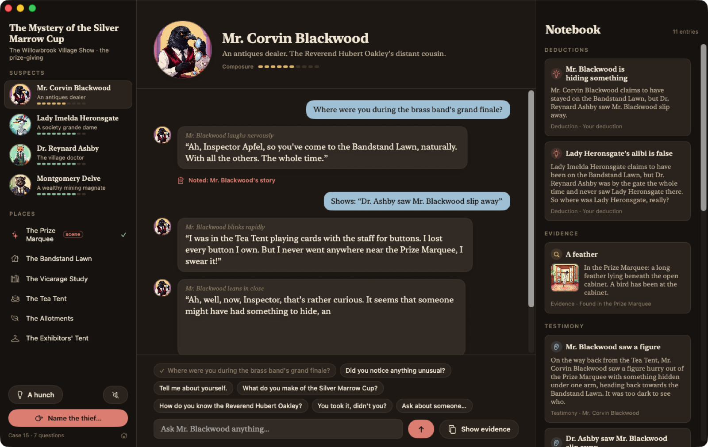
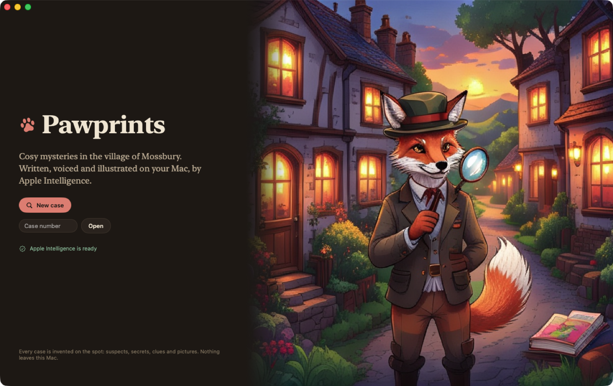
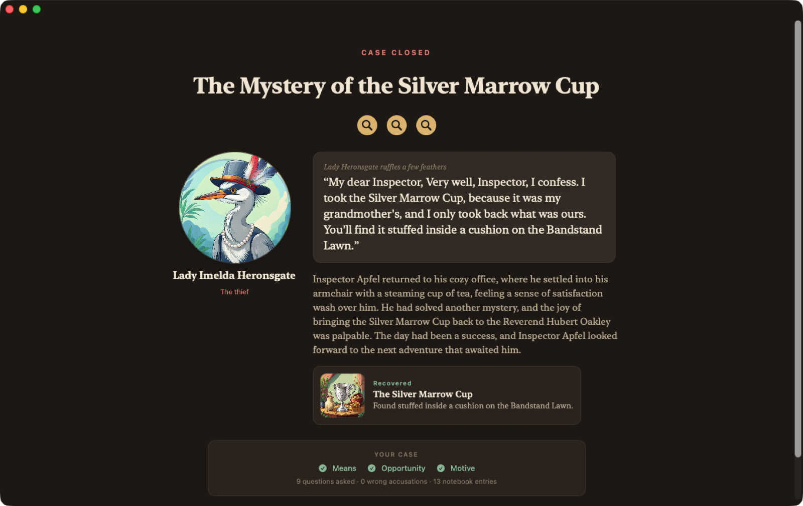

# Pawprints

**Cosy animal mysteries, invented, voiced and illustrated on your Mac by Apple Intelligence.**



Every case in the village of Mossbury is new: a stolen heirloom, four animal suspects, a red
herring with an embarrassing secret, and one thief with a motive. You question the suspects in
plain English (or click a suggestion), search the rooms, show suspects your evidence, and fill a
notebook. Then you name the thief and back it up with means, opportunity and motive.

Cases are built from 14 characters, 5 settings, 5 motives, 5 embarrassing secrets and three plots
(how the thief's alibi falls apart), so the route to the answer changes from case to case.

Nothing leaves the machine. Dialogue and narration come from the on-device
[Foundation Models](https://developer.apple.com/documentation/foundationmodels) language model
(the same model [apfel](https://github.com/Arthur-Ficial/apfel) exposes on the command line).
The pictures (title art, the cast, rooms and evidence) are painted by Image Playground's on-device
`ImageCreator`.

| | |
|---|---|
|  |  |

## Requirements

- macOS 26 or later on Apple Silicon, with Apple Intelligence turned on
- Xcode 26 / Swift 6.2+ command line tools, to build

## Build and run

```sh
scripts/build-app.sh          # builds dist/Pawprints.app (release, ad-hoc signed)
open dist/Pawprints.app
```

Image Playground only paints for a real, signed, frontmost app bundle, so use the script
rather than `swift run`.

Launch flags, handy for demos:

| Flag | |
|---|---|
| `--seed N` | open case N straight away (cases are deterministic, so you can share "case 4127") |
| `--resume` | continue the saved game |
| `--autoplay` | play the intended route by itself through the real UI |
| `--appearance light\|dark` | force an appearance |
| `--paint-all [file]` | paint every prompt in the content tables (or `key\|prompt` lines from a file) and log refusals |

```sh
open dist/Pawprints.app --args --seed 7 --autoplay
```

There is also a headless harness that plays a case against the real model in the terminal:

```sh
swift run pawprints-cli case 7     # print the generated case (spoilers!)
swift run pawprints-cli play 7     # play the intended route, printing every line
swift run pawprints-cli ask 7 2 "Did you see anyone near the Map Room?"
```

## How it works

A ~3B on-device model is a lovely voice actor and a poor game master. Left alone it repeats
itself, forgets its alibi, and makes up testimony. Pawprints is built around that split:
**the engine directs, the model acts.**

```
CaseGenerator (seeded, deterministic)
   └─ Case: plot, setting, item, 4 suspects with roles, trace, motive, secret, every notebook card
Engine (pure Swift, Codable)
   ├─ ask(suspect, topic) / present(card) / search(room) / accuse(…)
   └─ returns a Directive: mood, a note to the actor, and a first-person *script* with the facts
Voice (FoundationModels)
   ├─ understand(): whole-word rules, then a guided-generation classifier (@Generable anyOf)
   └─ perform(): a stateless session per line; the script restyled in the character's voice
Illustrator + Pawprints Painter (ImagePlayground)
   └─ paints the cover, cast, rooms and evidence in a short-lived helper app, cached on disk
```

Each case hides the answer behind a small chain of deductions. The trace at the scene
fits two suspects. One of them, the red herring, lied about where they were to hide something
embarrassing. Press them and they confess, and add that they glimpsed *a figure* hurrying from
the scene towards a particular room. Who claims to have been in that room? Depending on the
case's plot, the lie comes apart through a witness who was alone in that room, through a room
nobody actually sat in, or through a watcher by the door who never saw them in the crowd.

Lessons from probing the model, all built in:

- **The notebook is canon.** Every card's text is written by the engine, never the model, so
  the player can always trust the notebook, even when a suspect's turn of phrase drifts.
- **Facts are scripted, not improvised.** Asked to "reveal" a fact, the model got it fully
  right 2 times in 24. Given a first-person line to restyle in the character's voice, it keeps
  the names and places. Every reply is checked: if it names a suspect or room the script didn't
  mention, it is regenerated, and as a last resort the engine's own wording is used.
- **Stateless turns.** Replaying the transcript made the model copy its earlier answers word
  for word. Each line is a fresh session: persona + director's note + the question.
- **Guided generation everywhere.** `@Generable` output is the stop condition. Replies are
  streamed and cut after three sentences, because about 1 in 8 runs never closes its string.
  Gestures are picked from a fixed list (`.anyOf`) so they never copy an example or get the
  pronoun wrong.
- **A theft, not a murder.** Murder questions tripped the guardrails about 12% of the time;
  theft about 2%. The rare block gets an in-character deflection instead of an error.
- **Animals, not people.** Image Playground won't paint portraits of people, and refuses prompts
  with words like "lady", "vicar" or "brass band" (`conceptsRequirePersonIdentity`). Every prompt
  in the content tables was test-painted (`--paint-all`), and each has a plainer fallback.
- **The game still works without the model.** Every reply has an engine-written script, so if
  the model is busy or unavailable, suspects say their lines word for word.

## Pawprints Painter, and a note for apfel users

On macOS 26.5, once a process has used Image Playground, the system keeps Image Playground's
extension (`GPNonUIExtension`) alive for as long as that process runs. While it's alive,
command-line clients of the on-device language model, such as `apfel` and `apfel --serve`, fail
with `GenerationError error -1`. GUI apps are not affected. Quitting the app frees the model at once.

So the game never paints in its own process. It writes paint jobs to
`~/Library/Caches/Pawprints/queue/` and launches **Pawprints Painter**, a faceless helper inside
the app bundle. The helper paints the queue and quits after a couple of idle seconds, so `apfel`
is only blocked during an actual burst of painting, not for as long as the game is open. (Image
Playground only paints for a process with something on screen, so the helper shows a
transparent 2-point panel that never takes focus.)

## Tests

```sh
swift test
```

Covers the case generator (400 seeds are well-formed, the trace always points at exactly the
culprit and the red herring, all three plots occur), the engine (150 seeds solvable by each
plot's route and by both routes to "opportunity", a script behind every answer, wrong
accusations, the red herring breaking under pressure, save/load round trips) and the free-text
rules ("a skilled cook" is not violence; "did u see anybody" is a question about what they saw).
